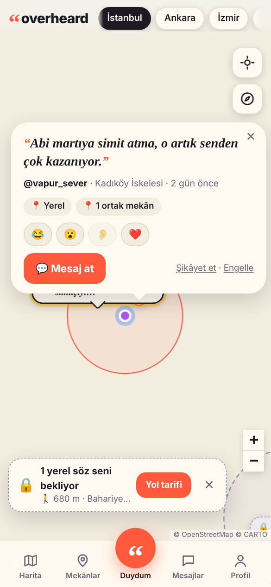
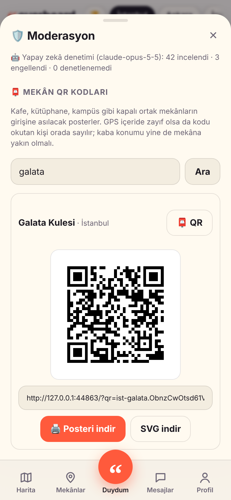
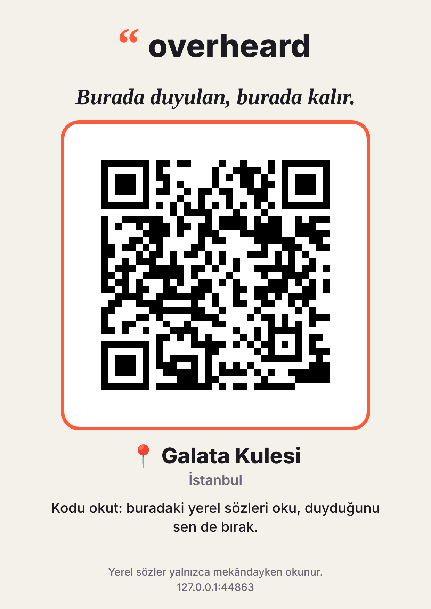
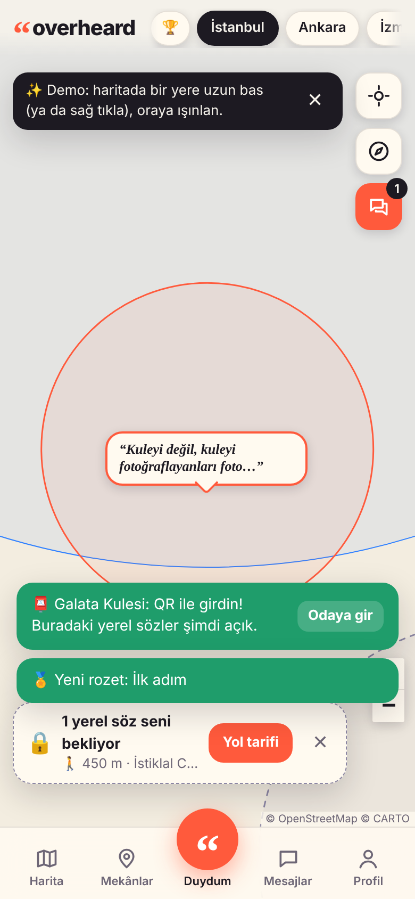
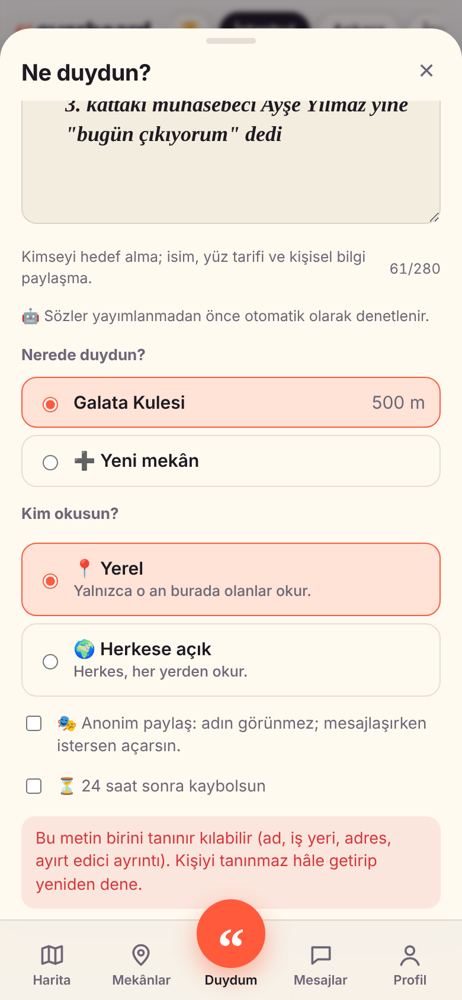
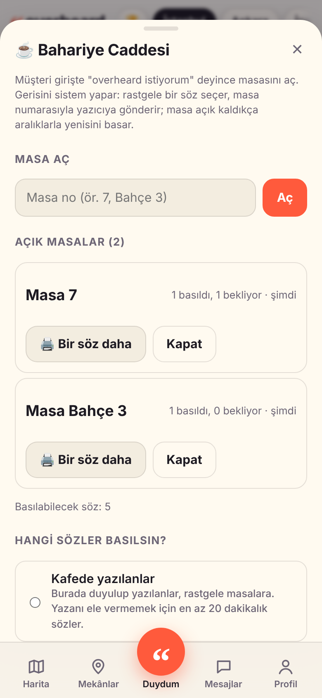
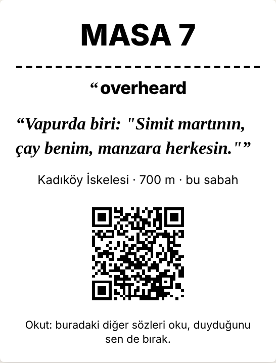

# overheard

> Duyduğunu bırak. Yerel sözleri yalnızca o an orada olanlar okur.

Overheard, insanların sokakta, vapurda, kampüste, kafede **kulak misafiri oldukları sözleri**
haritaya bıraktığı bir uygulama. Her söz, duyulduğu mekânda bir konuşma balonu olarak durur.

Fark yaratan kural: **iki tür söz var.**

- **Yerel söz** (varsayılan): yalnızca o mekânda **şu an** bulunanlar okur. Bir kez gidip okumak
  kalıcı erişim vermez; oradan ayrılınca (ya da konumun 30 dakikadır güncellenmediyse) söz yeniden
  kilitlenir. İstanbul'da bıraktığın yerel sözü Ankara'dan kimse okuyamaz. Overheard'ün yerelliği
  buradan gelir: okumak istiyorsan yürü, dışarı çık, oraya git.
- **Herkese açık söz**: herkes, her yerden okur (girişsiz bile).

Söz bırakmak için her iki durumda da o mekânda olmak gerekir. Yerel bir sözü okuduğunda yazanla o an
aynı yerdesinizdir; bu, tanışmak için en doğal an.

Ve sonra o sözün sahibine yazabilirsin: "Ben de oradaydım, o masada mıydın?" Böylece uygulama hem
insanları yürümeye hem de tanışmaya teşvik eder.

<p>
  
  
  
  
  
  
  
  
  
  
  
  
</p>

<sub>Ekran görüntüleri harita karolarına erişimi olmayan bir test ortamında alındı; gerçek kullanımda
balonların altında sokak haritası görünür.</sub>

## Neler var

- **Harita ve baloncuklar.** Yakından bakınca tek tek söz balonları, uzaktan bakınca mekân
  balonları. Bir balona dokununca büyük bir konuşma balonu olarak açılır. Çakışan balonlar
  küçük noktalara iner.
- **Kilitli yerel sözler.** Şu an bulunmadığın mekânların yerel sözleri bulanık, kilitli
  balonlardır. Metin sunucudan hiç gelmez (yalnızca uzunluğu), yani tarayıcıyı kurcalayarak da
  okunamaz. Balonda mekânın adı, ne kadar uzakta olduğun ve Google Maps'te **yürüyerek yol tarifi**
  vardır. Herkese açık sözler 🌍 işaretiyle her yerden okunur.
- **Check-in ve keşif modu.** "Konumum" düğmesi bulunduğun mekânlarda check-in yapar; keşif modu
  açıkken yürüdükçe otomatik check-in yapılır. Bir mekâna varınca "buradasın, yerel sözler açık",
  ayrılınca "yerel sözler kilitlendi" bildirimi gelir. Konum izni verdiysen uygulamayı açmak bile
  bulunduğun mekânın yerel sözlerini açar.
- **Kapalı alanda da orada kalmak (donanımsız).** Kafe, kütüphane, kampüs binası gibi yerlerde
  GPS içeride zayıflar. Mekâna iyi bir konumla (çoğunlukla kapıda) giren kişi, sonraki konumlar
  "hâlâ orada olabilir" dedikçe (mekân dairesi + 100 m + konum belirsizliği) 3 saate kadar orada
  sayılır; uygulama açıkken konum 5 dakikada bir sessizce tazelenir. Açıkça dışarıda gösteren bir
  konum (ör. 20 m doğrulukla 500 m ötede) çıkarır ve belirsiz konumla geri girilemez. Hiçbir
  mekâna bir şey asmak gerekmez.
- **Mekân QR kodu (isteğe bağlı).** Kapıda bile GPS'in olmadığı ortak mekânlar (bodrum kat, AVM
  içi) için: girişe asılan QR'ı okutan kişi kaba konumla (Wi-Fi/baz istasyonu, 1 km yakınlık) girer
  ve 2 saate kadar orada kalır. Kod, mekân kimliğinin sunucu sırrıyla imzasıdır (tahmin edilemez);
  posteri moderatör panelinden indirilir, mekân kendisi basıp asar.
- **Overheard Kafe.** Müşteri girişte garsona "overheard istiyorum" der; garson kafe panelinden
  masayı açar, gerisini uygulama yapar: rastgele bir söz seçer, masa numarasıyla kafenin fiş
  yazıcısına gönderir, masa açık kaldıkça (varsayılan 15 dk'da bir, en fazla 4 fiş) yenisini basar.
  İki mod: **kafede yazılanlar** (yazanı ele vermemek için en az 20 dk eski sözler, rastgele
  masalara) ya da **yakın çevreden** (kafe içi yazılmaz; 1,5 km içindeki mekânların herkese açık
  sözleri). Yakında söz yoksa (Sultanbeyli, Sancaktepe gibi sakin semtlerde) arama 5 km, 15 km ve
  en son şehrin geneline genişler; fişte sözün yeri ve uzaklığı yazar. Fişte yazar adı yok, saat yalnızca kabaca ("dün akşam") yazılır; altındaki QR okutan
  kafeye girer ve buradaki yerel sözleri açar. Yazıcı ekranı (`/yazici.html`) kafedeki bir
  cihazda personel hesabıyla açık durur; Chrome `--kiosk-printing` ile pencere açmadan basar.
  Kafeyi ve personelini moderatör panelinden yönetirsin.
- **Toplu taşıma hatları.** Metro, Marmaray, tramvay ve metrobüs hatları mekândır: bir durağa iyi
  bir konumla yaklaşınca hatta "binersin", konum güzergâha yakın kaldıkça (tünelde GPS yokken de)
  2 saate kadar hattasın; inip uzaklaşınca çıkarsın. Hat sözlerini yalnızca o an aynı hatta
  olanlar okur, hattın odasında yazışır. Haritada hattın güzergâhı çizilir, sözler güzergâh
  boyunca durur; kilitli hat sözünde yol tarifi en yakın durağa.
- **Çevrimdışı söz (metro, tünel).** Bağlantı yokken ya da tünelde konum alınamazken yazılan söz
  cihazda bekler; bağlantı gelince (uygulama açıkken hemen, destekleyen tarayıcılarda kapalıyken de
  arka planda) gönderilir. Sunucu o sırada orada olduğunu zamanında yapılmış bir giriş/biniş ya da
  cihazın o anki iyi konumuyla doğrular; söz yazıldığı anın saatiyle görünür, en geç 6 saat bekler,
  iki kez kaydedilmez. Uygulama çevrimdışı açılırsa son görülen harita gösterilir.
- **Kulaktan kulağa (eşten eşe, internetsiz).** Çevrimdışı sözünü ekranında QR olarak gösterir ya da
  AirDrop/Quick Share ile gönderirsin; yanındaki telefonun kamerasıyla okutur, sözü internet olmadan
  hemen okur ve o da taşır. Hanginiz önce bağlantı bulursa sözü sunucuya o ulaştırır (yazar "sözün
  @x sayesinde ulaştı" bildirimi alır). Söz yazarın cihaz anahtarıyla (ECDSA P-256, özel anahtar
  cihazdan çıkmaz) imzalanır: taşıyan değiştiremez, kimse başkası adına söz uyduramaz; "o sırada
  oradaydım" kanıtı yazarındır. Bağlantı adresin `#` sonrasında taşınır, sunucu kayıtlarına düşmez.
- **Android uygulaması ve yeraltı modu** ([`mobile/`](mobile/README.md), Flutter). Metroda internet
  yokken yazılan söz, aynı paket biçimiyle Bluetooth/Wi-Fi üzerinden (Google Nearby Connections)
  yanındaki telefonlara kendiliğinden geçer ve telefondan telefona yayılır; bağlantı bulan telefon
  sunucuya ulaştırır. Sunucu sözün kaç telefondan geçtiğini (`hops`) tutar; internetsiz yazılmış
  sözler haritada 📡 ile görünür.
- **Sakin semtler.** Hiç sözün olmadığı bir yerde harita "Bu civarda henüz söz yok, ilkini sen
  bırak" der; yakında bir Overheard Kafe varsa onu da gösterir. Bir mekânın ya da hattın ilk sözünü
  bırakan 🚩 **Öncü** rozetini alır.
- **Şu an burada ve mekân odası.** Her mekânda o an kaç kişinin bulunduğu (isimsiz) görünür. Bir
  mekândaysan oradakilerle grup sohbetine katılabilirsin; oda yalnızca oradayken görünür,
  mesajlar 12 saat sonra silinir.
- **Seni bekleyen sözler.** Haritanın altındaki kart en yakın, yerel sözü olan mekânı ve orada kaç
  sözün beklediğini gösterir; keşif modunda yaklaştıkça "Sıcak!" ipuçları gelir.
- **Haftanın en iyileri.** Şehir şeridindeki 🏆, son 7 günün en çok güldüren herkese açık sözlerini
  listeler.
- **Paylaşılabilir kartlar.** Herkese açık bir sözü tek dokunuşla Instagram hikâyesi boyutunda
  bir görsele çevirip paylaş (yazar adı görselde yer almaz; yerel sözler paylaşılamaz).
- **Söz bırakma.** Yalnızca o mekândayken. Yakında kayıtlı mekân yoksa yeriyle birlikte yeni
  mekânı sen açarsın.
- **Aynı anda oradaydınız.** Söz bırakıldığında sen de oradaysan balonda "Sen de oradaydın!"
  rozeti çıkar. Ayrıca yazanla kaç ortak mekânınız olduğu görünür.
- **"Ben de duydum" tanıkları.** 👂 yalnızca söz söylendiği sırada orada olanlara açıktır;
  basanlar balonda tanık olarak listelenir. Söz sahibi ve tanıklar birbirine yazabilir: aynı anı
  paylaşan yabancılar arasında doğal bir tanışma.
- **24 saatlik sözler.** İstersen sözün bir gün sonra kendiliğinden kaybolur.
- **Anonim paylaşım.** İstersen adın görünmez ("Anonim kulak"); biri sana yazarsa kimliğini o
  konuşmada açıp açmamak sana kalır.
- **Söz üzerinden mesajlaşma.** Her konuşma bir söze bağlıdır; sohbet başlığında sözün kendisi ve
  ortak mekânlarınız durur. Mesajlar canlı (Server-Sent Events) gelir.
- **Keşif motivasyonu.** Haftalık seri, şehir başına keşif yüzdesi ve rozetler (ilk adım, kâşif,
  haritacı, şehirlerarası, tanık, bağlantı…). Her yeni mekân bir adım daha.
- **Moderasyon.** Sözlerde telefon, e-posta, bağlantı, plaka ve @kişi otomatik gizlenir; küfür
  maskelenir, nefret söylemi reddedilir. Moderatör paneli: gizlenen sözleri gözden geçirme, geri
  yükleme, silme, yasaklama.
- **Bağlamı anlayan denetim (isteğe bağlı).** `ANTHROPIC_API_KEY` tanımlıysa herkese açık metinler
  (söz, yeni mekân adı, mekân odası mesajı) yayımlanmadan önce Claude'a sorulur: kelime
  listelerinin kaçırdığı birini tanınır kılan ayrıntılar ("3. kattaki muhasebeci Ayşe…"),
  listede olmayan nefret söylemi, taciz, tehdit, müstehcenlik ve reklam engellenir; yazar nedenini
  görür. Yalnızca metin gider (kullanıcı adı, konum, özel mesajlar gitmez). Servis hatası, hız
  sınırı ya da zaman aşımında metin kelime listesiyle denetlenip yayımlanır.
- **Kişisel veriler (KVKK/GDPR).** Kayıtta açık onay; Profil'den "Verilerimi indir" ve "Hesabımı
  sil"; kesin konum 24 saatte silinir. Taslak [gizlilik politikası](public/privacy.html) ve
  [kullanım koşulları](public/terms.html) (yayından önce doldurulup hukukçuya inceletilmeli).
- **Güvenlik.** Şikâyet (eşikte otomatik gizleme), engelleme, hız sınırları, CSP, Origin denetimi,
  özetlenmiş oturum belirteçleri, scrypt ile parola. Yazanın gerçek konumu saklanmaz/gösterilmez;
  balonlar mekân dairesi içinde sabit ama rastgele bir noktada durur.
- **Türkçe / English**, karanlık mod, ana ekrana eklenebilir (PWA).

## Pilot şehirler

| Şehir | Neden |
| --- | --- |
| İstanbul | Vapur iskeleleri, Kadıköy–Moda, İstiklal, kampüsler: kulak misafirliğinin başkenti |
| Ankara | Kızılay, Tunalı, 7. Cadde, ODTÜ ve Bilkent kampüsleri |
| İzmir | Kordon, Kemeraltı, Alsancak, Bostanlı sahili |
| Austin, Texas | 6th Street, South Congress, UT kampüsü, Zilker: yürünebilir, sosyal, genç |
| New York | Konseptin doğduğu şehir: *Overheard in New York* (2003) |
| Los Angeles | Bugün en büyük "overheard" topluluklarından birine ev sahipliği yapıyor |

Her şehir için başlangıç mekânları `server/data/places.js` içinde. Yeni bir şehir eklemek için
`server/data/cities.js` ve `places.js` dosyalarına satır eklemek yeterli.

## Çalıştırma

Gereken tek şey **Node.js 22.13+** (yerleşik `node:sqlite` kullanılır; tek isteğe bağlı bağımlılık yapay zekâ denetimi için Anthropic SDK'sı).

```bash
cd overheard
npm start            # http://localhost:8787
npm test             # API testleri
npm run test:e2e     # tarayıcıda uçtan uca testler (Playwright + Chromium)
```

Android uygulamasının derlenmesi ve iki telefonla denenmesi: [`mobile/README.md`](mobile/README.md).

### Semtlere mekân ve hat aktarma (OpenStreetMap)

Hazır gelen mekânlar şehir merkezindedir. Sultanbeyli, Sancaktepe, Sultangazi gibi turistik
olmayan semtlerde haritayı gündelik buluşma noktalarıyla (istasyon, otogar, iskele, semt pazarı,
AVM, meydan, park, halı saha, kampüs) doldurmak ve raylı sistem ile metrobüs hatlarını eklemek için:

```bash
npm run import:osm -- --city istanbul --district Sultanbeyli --district Sancaktepe --district Sultangazi
npm run import:osm -- --city istanbul --all-districts          # 39 ilçenin hepsi
npm run import:osm -- --city istanbul --lines --bus-ref 34,34A,34AS,34BZ,34C,34G,34Z
npm run import:osm -- --city istanbul --district Sultanbeyli --dry-run   # yazmadan önizle
```

Okullar, hastaneler, ibadethaneler, karakol ve cezaevleri bilerek alınmaz. Var olan bir mekânla
aynı yerdekiler atlanır; tekrar çalıştırmak güvenlidir. Veri Overpass API'den gelir (ağ erişimi
gerekir; vekil arkasında `NODE_USE_ENV_PROXY=1`). Ağsız ortamda başka yerde indirilmiş bir Overpass
yanıtı `--from-file` ile aktarılabilir. Veri © OpenStreetMap katkıcıları, ODbL.

### Google Maps

`GOOGLE_MAPS_API_KEY` verilirse harita Google Maps JavaScript API ile çizilir: balonlar
`OverlayView` ile aynı görünümde, açılan balon `InfoWindow` içinde. Anahtar yoksa, betik
yüklenemezse ya da Google anahtarı reddederse uygulama kendiliğinden OpenStreetMap'e (Leaflet)
döner. Kilitli sözlerdeki "Yol tarifi" her iki durumda da Google Maps yürüyüş rotasını açar.

Anahtar tarayıcıya gider (Maps JS anahtarları doğası gereği herkese açıktır). Google Cloud
konsolunda anahtarı **HTTP yönlendiren** kısıtıyla yalnızca kendi alan adınıza ve yalnızca
*Maps JavaScript API*'ye kısıtlayın.

```bash
GOOGLE_MAPS_API_KEY=AIza... OVERHEARD_DEMO=0 npm start
```

Ortam değişkenleri:

| Değişken | Varsayılan | Açıklama |
| --- | --- | --- |
| `PORT` | `8787` | |
| `OVERHEARD_DB` | `data/overheard.db` | SQLite dosyası |
| `OVERHEARD_DEMO` | `1` | Demo modu: örnek sözler, misafir hesabı, haritaya uzun basınca ışınlanma. Üretimde `0`. |
| `OVERHEARD_SECURE_COOKIES` | `0` | HTTPS arkasında `1` yap |
| `GOOGLE_MAPS_API_KEY` | — | Tanımlıysa harita Google Maps ile çizilir (yoksa OpenStreetMap) |
| `OVERHEARD_ADMINS` | — | Moderasyon paneline erişecek kullanıcı adları, virgülle (`ayse,mert`) |

### Demo modunda deneme

1. Uygulamayı aç, **Profil → Giriş yap → Hesapsız dene (misafir)**.
2. Haritada yakınlaş: yerel sözler 🔒 kilitli, herkese açık olanlar (🌍) okunur.
3. Bir kilitli balona dokun → **Buraya ışınlan** (ya da haritada bir yere uzun bas / sağ tıkla).
4. O mekândayken yerel sözler açılır. Tepki ver, **Mesaj at**. Başka bir yere ışınlanınca yeniden
   kilitlenir; başlattığın konuşma ise sürer.
5. Ortadaki **“ Duydum** düğmesiyle kendi sözünü bırak; yerel mi herkese açık mı olacağını seç.

## Dağıtım

**Docker + otomatik HTTPS (Caddy):**

```bash
cd overheard
OVERHEARD_DOMAIN=overheard.example.com \
OVERHEARD_ADMINS=ayse \
GOOGLE_MAPS_API_KEY=AIza... \
docker compose up -d
```

İmaj üretim ayarlarıyla gelir: demo kapalı (`OVERHEARD_DEMO=0`), güvenli çerez + HSTS açık,
veritabanı `/data` biriminde, uygulama yetkisiz `node` kullanıcısıyla çalışır, `/healthz`
sağlık denetimi tanımlı. Compose dosyası Caddy'yi önüne koyar ve `OVERHEARD_TRUST_PROXY=1`
ile hız sınırları gerçek istemci adresine göre işler.

**Docker olmadan:** Node.js 22.13+ olan bir sunucuda
`OVERHEARD_DEMO=0 OVERHEARD_SECURE_COOKIES=1 OVERHEARD_TRUST_PROXY=1 npm start`, önüne HTTPS
sonlandıran bir ters vekil (Caddy/nginx). Konum API'si tarayıcıda yalnızca HTTPS'te çalışır.

**Yedekleme:** `npm run backup [klasör]` çalışan veritabanının tutarlı bir kopyasını alır
(SQLite `VACUUM INTO`). Konteynerde: `docker compose exec app node server/backup.js /data/backups`.
Bunu günlük bir zamanlayıcıya bağlayıp yedekleri sunucu dışına kopyalayın.

| Ek değişken | Varsayılan | Açıklama |
| --- | --- | --- |
| `OVERHEARD_TRUST_PROXY` | `0` | Ters vekil arkasında `1`: istemci adresi `X-Forwarded-For`'un son öğesi |
| `OVERHEARD_RATE_SCALE` | `1` | Hız sınırı çarpanı |
| `OVERHEARD_ANTI_SPOOF` | demo kapalıysa `1` | Konum sahteciliği denetimleri |
| `OVERHEARD_PUBLIC_URL` | istek adresi | QR bağlantılarının kökü, ör. `https://overheard.example.com` |
| `OVERHEARD_QR_SECRET` | veritabanında üretilir | Mekân QR imzası sırrı; değiştirmek basılı tüm QR posterlerini geçersiz kılar |
| `ANTHROPIC_API_KEY` | — | Tanımlıysa yapay zekâ denetimi açılır (Claude API) |
| `OVERHEARD_AI_MODERATION` | anahtar varsa `1` | Yapay zekâ denetimini aç/kapat |
| `OVERHEARD_AI_MODEL` | `claude-opus-5-5` | Denetim modeli. Yüksek hacimde daha ucuz: `claude-haiku-5-5` (yedek model desteği yok: `OVERHEARD_AI_FALLBACKS=0`) |
| `OVERHEARD_AI_TIMEOUT_MS` | `8000` | Bu süreyi aşan denetim beklenmez; metin kelime listesiyle yayımlanır |
| `OVERHEARD_AI_FALLBACKS` | `1` | Sunucu taraflı yedek model (`fallbacks: "default"`): bir istek reddedilirse Anthropic'in önerdiği modelde aynı çağrıda yeniden denenir |

## Mimari

```
overheard/
  server/
    index.js        giriş noktası (HTTP sunucusu)
    backup.js       tutarlı veritabanı yedeği (VACUUM INTO)
    app.js          istek işleyici: statik dosyalar, güvenlik başlıkları, API yönlendirme
    api.js          API uçları
    domain.js       kurallar: yerel/herkese açık görünürlük, check-in, sözler, mesajlaşma
    db.js           SQLite şeması ve göçler (PRAGMA user_version)
    auth.js         scrypt parolalar, oturumlar
    moderation.js   kişisel veri ve küfür maskesi, nefret söylemi reddi
    events.js       Server-Sent Events (canlı mesaj)
    geo.js          mesafe, sınır kutusu, balon yerleşimi
    data/           pilot şehirler, mekânlar, demo sözleri
  public/           derleme adımı olmayan mobil web uygulaması (ES modülleri)
    js/map.js       harita cephesi: Google Maps ya da Leaflet seçer, gerekirse geri döner
    js/maps/        ortak balon planı + Leaflet ve Google Maps uyarlayıcıları
  test/             node:test ile API testleri, test/e2e/ altında Playwright senaryoları
```

### Görünürlük kuralı

```
okuyabilir(kullanıcı, söz) = söz herkese açık
                           ∨ kullanıcı sözün sahibi
                           ∨ kullanıcı şu an söz.mekân'da
şu an mekânda = son konum bildirimi ≤ 30 dk önce ∧ konum mekân dairesinin içinde
                ∧ kullanıcı orada check-in yapabilmiş
```

Kilitli sözler istemciye `{ locked: true, length }` olarak gider; metin, yazar ve tepki
ayrıntıları gönderilmez. Tepki vermek, şikâyet etmek ve yeni konuşma başlatmak da aynı kurala
tabidir; başlamış bir konuşma ise mekândan ayrıldıktan sonra da sürer. "Ortak mekân" sayısı
(ikinizin de uğradığı mekânlar) balonda ve sohbet başlığında sosyal bir ipucu olarak görünür.

### API özeti

| Uç | Açıklama |
| --- | --- |
| `GET /api/config` | Pilot şehirler, sınırlar, demo modu |
| `POST /api/auth/register` · `login` · `guest` · `upgrade` · `logout` | Hesap (`upgrade`: misafiri kalıcı hesaba çevirir) |
| `GET /api/me` | Kullanıcı, istatistikler, okunmamış mesaj sayısı |
| `GET /api/cities/:id/map` | Şehrin mekânları (söz sayılarıyla) ve en yeni 300 sözü (görüntüleyene göre kilitli/açık) |
| `GET /api/cities/:id/best` | Haftanın en iyileri (herkese açık sözler) |
| `GET /api/overheards?bbox=minLng,minLat,maxLng,maxLat` | Görünür alandaki sözler (en fazla 300; alan ≤ 0,6°) |
| `POST /api/checkins` | `{lat, lng, accuracy}` → şu an bulunduğun mekânlar (`arrived`, `firstVisit`) ve ayrıldıkların (`left`) |
| `POST /api/checkins/qr` | `{code, lat, lng, accuracy}` → mekân QR kodu ile giriş (kaba konum yeter; uzaksa `blocked: "qr_too_far"`) |
| `GET /api/me/places` | Uğradığın ve şu an bulunduğun mekânlar |
| `GET /api/me/export` · `POST /api/me/delete` | Verilerimi indir (JSON) · hesabı sil (`{password}`) |
| `POST /api/overheards` | `{text, lat, lng, visibility: local\|public, anonymous?, ephemeral?, placeId?, newPlaceName?}` |
| `GET/DELETE /api/overheards/:id` | |
| `POST /api/overheards/:id/reactions` · `report` | `kind: same` yalnızca o sırada orada olanlara |
| `POST /api/overheards/:id/messages` | `{body, to?}`: sahibine ya da (`to`) bir tanığa yazar |
| `GET /api/conversations` · `GET /api/conversations/:id?before=` · `POST …/messages` | Mesajlar 100'erli sayfalanır |
| `POST /api/conversations/:id/reveal` | Anonim söz sahibi kimliğini açar |
| `GET/POST /api/places/:id/room` | Mekân odası (yalnızca o an mekândayken) |
| `POST /api/overheards/:id/block-author` · `POST /api/users/:handle/block` | Engelleme |
| `GET /api/admin/reports` · `POST …/overheards/:id/restore` · `DELETE …/overheards/:id` · `POST …/users/:handle/ban` | Moderasyon (yalnızca `OVERHEARD_ADMINS`) |
| `GET /api/admin/places?q=` · `GET /api/admin/places/:id/qr` | Mekân arama ve QR kodu (`url`, `svg`, `matrix`) |
| `GET/POST/DELETE /api/admin/venues/:placeId` · `POST/DELETE …/staff` | Overheard Kafe kurma, personel (yalnızca moderatör) |
| `GET /api/venues/:placeId` · `POST …/settings` · `POST …/tables` · `POST …/tables/:id/print` · `POST …/tables/:id/close` | Kafe paneli (personel): mod, masa açma, bir fiş daha, kapatma |
| `GET /api/venues/:placeId/jobs` · `POST …/jobs/:id/printed` | Yazıcı kuyruğu (fişler + kafe QR'ı); yeni fişte personele SSE `print` |
| `POST /api/overheards/offline` | `{clientId, text, placeId, heardAt, fix?, …}` → çevrimdışı yazılmış söz (kanıt: o sıradaki giriş ya da `fix`) |
| `POST /api/me/device-keys` · `POST /api/overheards/relay` | Cihaz imza anahtarı (açık yarı) · kulaktan kulağa taşınan imzalı söz `{p: "<veri>.<anahtar>.<imza>", hops?}` (`hops`: Bluetooth ağında kaç telefondan geçtiği); yazara SSE `relayed` |
| `GET /api/events` | SSE akışı (`dm`, `reveal`, `room` olayları) |

## Testler

| Komut | Kapsam |
| --- | --- |
| `npm test` | 110 API/birim testi: yerel/herkese açık görünürlük ve anlık mekân kuralı, check-in, söz, tepki, tanıklar, anonimlik, mesajlaşma, rozetler, moderasyon, konum denetimleri, QR, kafe, hatlar, çevrimdışı ve kulaktan kulağa söz, ölçek, göçler, yedekleme |
| `npm run test:e2e` | 23 tarayıcı senaryosu (Playwright + Chromium): iki kullanıcıyla uçtan uca akış, ayrılınca yeniden kilitlenme ve herkese açık söz, tanık ve anonim sohbet, keşif kartı, rozetler, tanıtım, dil değişimi, moderasyon paneli, yoğun bölge, Google Maps uyarlayıcısı (taklit API ile), QR, kafe, çevrimdışı ve kulaktan kulağa |
| `cd mobile && flutter test` | 28 Android uygulaması testi: imza (web/sunucu biçimi), paket, telefondan telefona yayılma (bellek içi ağda zincir, üçgen, atlama ve süre sınırı, denetim), içerik denetiminin Node sürümüyle eşliği, ekranlar ve gerçek sunucuyla uçtan uca (Dart'ta imzalanan sözün Node'da doğrulanması, tepki, mesajlaşma, şikâyet/engelleme, hesap silme) |

Testler bellek içi veritabanıyla gerçek bir HTTP sunucusu açar; dış ağa çıkmaz (harita karoları
ve Google Maps API'si testte taklit edilir).

## Konum güvenilirliği

Tarayıcıdan gelen konum kriptografik olarak doğrulanamaz. Üretimde (`OVERHEARD_DEMO=0`) şu
denetimler açıktır (`OVERHEARD_ANTI_SPOOF` ile değiştirilebilir):

- 200 m'den belirsiz konum mekân açmaz.
- Son güvenilir konuma göre 5 km'den uzun ve 1000 km/sa'ten hızlı sıçrama "imkânsız seyahat"
  sayılır ve işaretlenir (uçakla mümkün yolculuklar geçer).
- 24 saatte 3 şüpheli olaydan sonra check-in'ler 24 saat mekân açmaz.
- Saatte en fazla 30 yeni mekân açılabilir.
- Şüpheli hesaplar moderatör panelinde listelenir.
- Mekâna girmek için iyi bir konum (200 m'den iyi doğruluk) gerekir. Girdikten sonraki belirsiz
  konumlar yalnızca içeride kalmayı sağlar, yeni mekân açmaz; tutunma 3 saatle sınırlıdır.
- Mekân QR koduyla girişte konum doğruluğu 3 km'ye kadar kabul edilir ama konum mekâna 1 km
  yakın olmalı: kodun fotoğrafı evden okutulamaz. QR ile içeride kalmak 2 saatle sınırlıdır.

## Bilinen sınırlar

- Yukarıdaki denetimler kaba sahteciliği frenler ama kararlı bir kullanıcıyı (yavaş yavaş sahte
  konumla "yürüyen") durduramaz. Kesin çözüm için yerli uygulama + cihaz doğrulaması (App Attest /
  Play Integrity) ya da BLE işaretçileri gerekir. Mekân QR kodu kapalı alanlarda yardımcı olur ama
  sabit bir koddur: mekâna bir kez giden biri fotoğrafını alıp 1 km yakınından yeniden okutabilir
  (dönen kod ya da ekranda gösterilen QR bu açığı kapatır).
- Kulaktan kulağa tarayıcıda kullanıcının bir hamlesiyle (QR okutma, AirDrop/Quick Share) çalışır.
  Telefonların internetsiz, kendiliğinden birbirini bulması tarayıcıdan yapılamaz (iOS Safari
  Bluetooth'a izin vermez, WebRTC bağlantı kurmak için sunucu ister); bunu Android uygulaması
  (`mobile/`, Nearby Connections) yapar. iPhone için bağlantı katmanı (Multipeer Connectivity ya da
  BLE) henüz yok. Sunucu
  tarafı (imzalı paket, aktarma ucu) buna hazırdır. Kodu telefonun kamera uygulamasıyla okutan
  kişinin tarayıcısı Overheard'ü daha önce açmış olmalı (çevrimdışı kabuk önbellekte).
- Hız sınırları ve canlı bağlantılar tek süreç içindedir; yatay ölçeklemede paylaşılan bir depo
  (ör. Redis) gerekir.
- Harita karoları CARTO/OpenStreetMap'ten gelir; yoğun kullanımda kendi karo sunucunuz ya da
  ücretli bir sağlayıcı gerekir.

Yol haritası ve sıradaki adımlar: [ROADMAP.md](ROADMAP.md).
