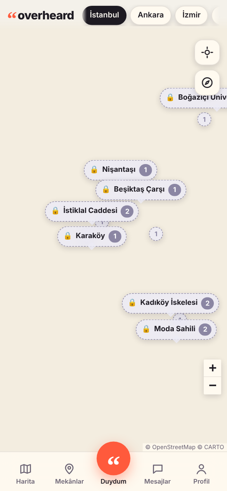
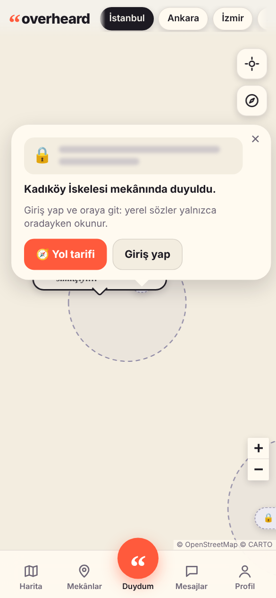
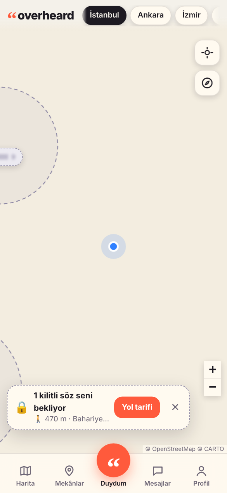
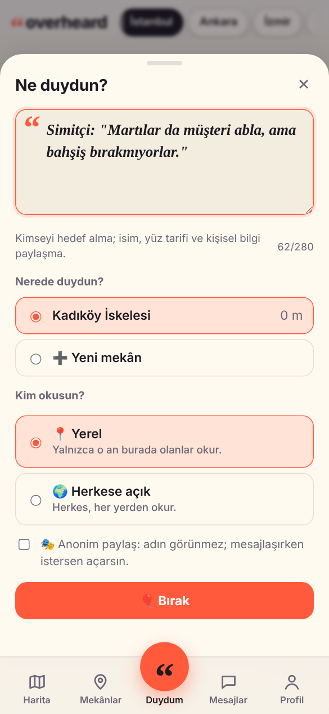
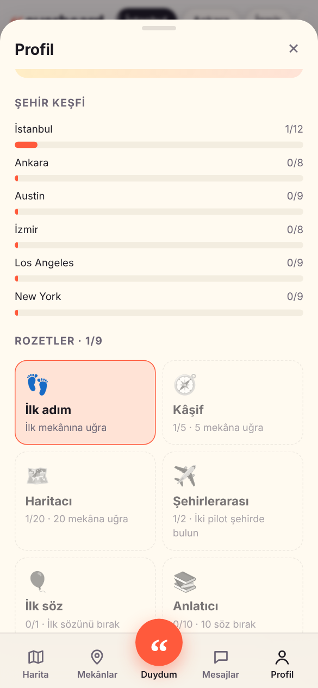

# overheard

> Duyduğunu bırak. Yerel sözleri yalnızca o an orada olanlar okur.

Overheard, insanların sokakta, vapurda, kampüste, kafede **kulak misafiri oldukları sözleri**
haritaya bıraktığı bir uygulama. Her söz, duyulduğu mekânda bir konuşma balonu olarak durur.

Fark yaratan kural: **iki tür söz var.**

- **Yerel söz** (varsayılan): yalnızca o mekânda **şu an** bulunanlar okur. Bir kez gidip okumak
  kalıcı erişim vermez; oradan ayrılınca (ya da konumun 30 dakikadır güncellenmediyse) söz yeniden
  kilitlenir. İstanbul'da bıraktığın yerel sözü Ankara'dan kimse okuyamaz. Overheard'ün yerelliği
  buradan gelir: okumak istiyorsan yürü, dışarı çık, oraya git.
- **Herkese açık söz**: herkes, her yerden okur (girişsiz bile).

Söz bırakmak için her iki durumda da o mekânda olmak gerekir. Yerel bir sözü okuduğunda yazanla o an
aynı yerdesinizdir; bu, tanışmak için en doğal an.

Ve sonra o sözün sahibine yazabilirsin: "Ben de oradaydım, o masada mıydın?" Böylece uygulama hem
insanları yürümeye hem de tanışmaya teşvik eder.

<p>
  
  
  
  
  
  
</p>

<sub>Ekran görüntüleri harita karolarına erişimi olmayan bir test ortamında alındı; gerçek kullanımda
balonların altında sokak haritası görünür.</sub>

## Neler var

- **Harita ve baloncuklar.** Yakından bakınca tek tek söz balonları, uzaktan bakınca mekân
  balonları. Bir balona dokununca büyük bir konuşma balonu olarak açılır. Çakışan balonlar
  küçük noktalara iner.
- **Kilitli yerel sözler.** Şu an bulunmadığın mekânların yerel sözleri bulanık, kilitli
  balonlardır. Metin sunucudan hiç gelmez (yalnızca uzunluğu), yani tarayıcıyı kurcalayarak da
  okunamaz. Balonda mekânın adı, ne kadar uzakta olduğun ve Google Maps'te **yürüyerek yol tarifi**
  vardır. Herkese açık sözler 🌍 işaretiyle her yerden okunur.
- **Check-in ve keşif modu.** "Konumum" düğmesi bulunduğun mekânlarda check-in yapar; keşif modu
  açıkken yürüdükçe otomatik check-in yapılır. Bir mekâna varınca "buradasın, yerel sözler açık",
  ayrılınca "yerel sözler kilitlendi" bildirimi gelir. Konum izni verdiysen uygulamayı açmak bile
  bulunduğun mekânın yerel sözlerini açar.
- **Şu an burada ve mekân odası.** Her mekânda o an kaç kişinin bulunduğu (isimsiz) görünür. Bir
  mekândaysan oradakilerle grup sohbetine katılabilirsin; oda yalnızca oradayken görünür,
  mesajlar 12 saat sonra silinir.
- **Seni bekleyen sözler.** Haritanın altındaki kart en yakın, yerel sözü olan mekânı ve orada kaç
  sözün beklediğini gösterir; keşif modunda yaklaştıkça "Sıcak!" ipuçları gelir.
- **Paylaşılabilir kartlar.** Herkese açık bir sözü tek dokunuşla Instagram hikâyesi boyutunda
  bir görsele çevirip paylaş (yazar adı görselde yer almaz; yerel sözler paylaşılamaz).
- **Söz bırakma.** Yalnızca o mekândayken. Yakında kayıtlı mekân yoksa yeriyle birlikte yeni
  mekânı sen açarsın.
- **Aynı anda oradaydınız.** Söz bırakıldığında sen de oradaysan balonda "Sen de oradaydın!"
  rozeti çıkar. Ayrıca yazanla kaç ortak mekânınız olduğu görünür.
- **"Ben de duydum" tanıkları.** 👂 yalnızca söz söylendiği sırada orada olanlara açıktır;
  basanlar balonda tanık olarak listelenir. Söz sahibi ve tanıklar birbirine yazabilir: aynı anı
  paylaşan yabancılar arasında doğal bir tanışma.
- **Anonim paylaşım.** İstersen adın görünmez ("Anonim kulak"); biri sana yazarsa kimliğini o
  konuşmada açıp açmamak sana kalır.
- **Söz üzerinden mesajlaşma.** Her konuşma bir söze bağlıdır; sohbet başlığında sözün kendisi ve
  ortak mekânlarınız durur. Mesajlar canlı (Server-Sent Events) gelir.
- **Keşif motivasyonu.** Haftalık seri, şehir başına keşif yüzdesi ve rozetler (ilk adım, kâşif,
  haritacı, şehirlerarası, tanık, bağlantı…). Her yeni mekân bir adım daha.
- **Moderasyon.** Sözlerde telefon, e-posta, bağlantı, plaka ve @kişi otomatik gizlenir; küfür
  maskelenir, nefret söylemi reddedilir. Moderatör paneli: gizlenen sözleri gözden geçirme, geri
  yükleme, silme, yasaklama.
- **Kişisel veriler (KVKK/GDPR).** Kayıtta açık onay; Profil'den "Verilerimi indir" ve "Hesabımı
  sil"; kesin konum 24 saatte silinir. Taslak [gizlilik politikası](public/privacy.html) ve
  [kullanım koşulları](public/terms.html) (yayından önce doldurulup hukukçuya inceletilmeli).
- **Güvenlik.** Şikâyet (eşikte otomatik gizleme), engelleme, hız sınırları, CSP, Origin denetimi,
  özetlenmiş oturum belirteçleri, scrypt ile parola. Yazanın gerçek konumu saklanmaz/gösterilmez;
  balonlar mekân dairesi içinde sabit ama rastgele bir noktada durur.
- **Türkçe / English**, karanlık mod, ana ekrana eklenebilir (PWA).

## Pilot şehirler

| Şehir | Neden |
| --- | --- |
| İstanbul | Vapur iskeleleri, Kadıköy–Moda, İstiklal, kampüsler: kulak misafirliğinin başkenti |
| Ankara | Kızılay, Tunalı, 7. Cadde, ODTÜ ve Bilkent kampüsleri |
| İzmir | Kordon, Kemeraltı, Alsancak, Bostanlı sahili |
| Austin, Texas | 6th Street, South Congress, UT kampüsü, Zilker: yürünebilir, sosyal, genç |
| New York | Konseptin doğduğu şehir: *Overheard in New York* (2003) |
| Los Angeles | Bugün en büyük "overheard" topluluklarından birine ev sahipliği yapıyor |

Her şehir için başlangıç mekânları `server/data/places.js` içinde. Yeni bir şehir eklemek için
`server/data/cities.js` ve `places.js` dosyalarına satır eklemek yeterli.

## Çalıştırma

Gereken tek şey **Node.js 22.13+** (yerleşik `node:sqlite` kullanılır; çalışma zamanı bağımlılığı yok).

```bash
cd overheard
npm start            # http://localhost:8787
npm test             # API testleri
npm run test:e2e     # tarayıcıda uçtan uca testler (Playwright + Chromium)
```

### Google Maps

`GOOGLE_MAPS_API_KEY` verilirse harita Google Maps JavaScript API ile çizilir: balonlar
`OverlayView` ile aynı görünümde, açılan balon `InfoWindow` içinde. Anahtar yoksa, betik
yüklenemezse ya da Google anahtarı reddederse uygulama kendiliğinden OpenStreetMap'e (Leaflet)
döner. Kilitli sözlerdeki "Yol tarifi" her iki durumda da Google Maps yürüyüş rotasını açar.

Anahtar tarayıcıya gider (Maps JS anahtarları doğası gereği herkese açıktır). Google Cloud
konsolunda anahtarı **HTTP yönlendiren** kısıtıyla yalnızca kendi alan adınıza ve yalnızca
*Maps JavaScript API*'ye kısıtlayın.

```bash
GOOGLE_MAPS_API_KEY=AIza... OVERHEARD_DEMO=0 npm start
```

Ortam değişkenleri:

| Değişken | Varsayılan | Açıklama |
| --- | --- | --- |
| `PORT` | `8787` | |
| `OVERHEARD_DB` | `data/overheard.db` | SQLite dosyası |
| `OVERHEARD_DEMO` | `1` | Demo modu: örnek sözler, misafir hesabı, haritaya uzun basınca ışınlanma. Üretimde `0`. |
| `OVERHEARD_SECURE_COOKIES` | `0` | HTTPS arkasında `1` yap |
| `GOOGLE_MAPS_API_KEY` | — | Tanımlıysa harita Google Maps ile çizilir (yoksa OpenStreetMap) |
| `OVERHEARD_ADMINS` | — | Moderasyon paneline erişecek kullanıcı adları, virgülle (`ayse,mert`) |

### Demo modunda deneme

1. Uygulamayı aç, **Profil → Giriş yap → Hesapsız dene (misafir)**.
2. Haritada yakınlaş: yerel sözler 🔒 kilitli, herkese açık olanlar (🌍) okunur.
3. Bir kilitli balona dokun → **Buraya ışınlan** (ya da haritada bir yere uzun bas / sağ tıkla).
4. O mekândayken yerel sözler açılır. Tepki ver, **Mesaj at**. Başka bir yere ışınlanınca yeniden
   kilitlenir; başlattığın konuşma ise sürer.
5. Ortadaki **“ Duydum** düğmesiyle kendi sözünü bırak; yerel mi herkese açık mı olacağını seç.

## Dağıtım

**Docker + otomatik HTTPS (Caddy):**

```bash
cd overheard
OVERHEARD_DOMAIN=overheard.example.com \
OVERHEARD_ADMINS=ayse \
GOOGLE_MAPS_API_KEY=AIza... \
docker compose up -d
```

İmaj üretim ayarlarıyla gelir: demo kapalı (`OVERHEARD_DEMO=0`), güvenli çerez + HSTS açık,
veritabanı `/data` biriminde, uygulama yetkisiz `node` kullanıcısıyla çalışır, `/healthz`
sağlık denetimi tanımlı. Compose dosyası Caddy'yi önüne koyar ve `OVERHEARD_TRUST_PROXY=1`
ile hız sınırları gerçek istemci adresine göre işler.

**Docker olmadan:** Node.js 22.13+ olan bir sunucuda
`OVERHEARD_DEMO=0 OVERHEARD_SECURE_COOKIES=1 OVERHEARD_TRUST_PROXY=1 npm start`, önüne HTTPS
sonlandıran bir ters vekil (Caddy/nginx). Konum API'si tarayıcıda yalnızca HTTPS'te çalışır.

**Yedekleme:** `npm run backup [klasör]` çalışan veritabanının tutarlı bir kopyasını alır
(SQLite `VACUUM INTO`). Konteynerde: `docker compose exec app node server/backup.js /data/backups`.
Bunu günlük bir zamanlayıcıya bağlayıp yedekleri sunucu dışına kopyalayın.

| Ek değişken | Varsayılan | Açıklama |
| --- | --- | --- |
| `OVERHEARD_TRUST_PROXY` | `0` | Ters vekil arkasında `1`: istemci adresi `X-Forwarded-For`'un son öğesi |
| `OVERHEARD_RATE_SCALE` | `1` | Hız sınırı çarpanı |
| `OVERHEARD_ANTI_SPOOF` | demo kapalıysa `1` | Konum sahteciliği denetimleri |

## Mimari

```
overheard/
  server/
    index.js        giriş noktası (HTTP sunucusu)
    backup.js       tutarlı veritabanı yedeği (VACUUM INTO)
    app.js          istek işleyici: statik dosyalar, güvenlik başlıkları, API yönlendirme
    api.js          API uçları
    domain.js       kurallar: yerel/herkese açık görünürlük, check-in, sözler, mesajlaşma
    db.js           SQLite şeması ve göçler (PRAGMA user_version)
    auth.js         scrypt parolalar, oturumlar
    moderation.js   kişisel veri ve küfür maskesi, nefret söylemi reddi
    events.js       Server-Sent Events (canlı mesaj)
    geo.js          mesafe, sınır kutusu, balon yerleşimi
    data/           pilot şehirler, mekânlar, demo sözleri
  public/           derleme adımı olmayan mobil web uygulaması (ES modülleri)
    js/map.js       harita cephesi: Google Maps ya da Leaflet seçer, gerekirse geri döner
    js/maps/        ortak balon planı + Leaflet ve Google Maps uyarlayıcıları
  test/             node:test ile API testleri, test/e2e/ altında Playwright senaryoları
```

### Görünürlük kuralı

```
okuyabilir(kullanıcı, söz) = söz herkese açık
                           ∨ kullanıcı sözün sahibi
                           ∨ kullanıcı şu an söz.mekân'da
şu an mekânda = son konum bildirimi ≤ 30 dk önce ∧ konum mekân dairesinin içinde
                ∧ kullanıcı orada check-in yapabilmiş
```

Kilitli sözler istemciye `{ locked: true, length }` olarak gider; metin, yazar ve tepki
ayrıntıları gönderilmez. Tepki vermek, şikâyet etmek ve yeni konuşma başlatmak da aynı kurala
tabidir; başlamış bir konuşma ise mekândan ayrıldıktan sonra da sürer. "Ortak mekân" sayısı
(ikinizin de uğradığı mekânlar) balonda ve sohbet başlığında sosyal bir ipucu olarak görünür.

### API özeti

| Uç | Açıklama |
| --- | --- |
| `GET /api/config` | Pilot şehirler, sınırlar, demo modu |
| `POST /api/auth/register` · `login` · `guest` · `upgrade` · `logout` | Hesap (`upgrade`: misafiri kalıcı hesaba çevirir) |
| `GET /api/me` | Kullanıcı, istatistikler, okunmamış mesaj sayısı |
| `GET /api/cities/:id/map` | Şehrin mekânları (söz sayılarıyla) ve en yeni 300 sözü (görüntüleyene göre kilitli/açık) |
| `GET /api/overheards?bbox=minLng,minLat,maxLng,maxLat` | Görünür alandaki sözler (en fazla 300; alan ≤ 0,6°) |
| `POST /api/checkins` | `{lat, lng, accuracy}` → şu an bulunduğun mekânlar (`arrived`, `firstVisit`) ve ayrıldıkların (`left`) |
| `GET /api/me/places` | Uğradığın ve şu an bulunduğun mekânlar |
| `GET /api/me/export` · `POST /api/me/delete` | Verilerimi indir (JSON) · hesabı sil (`{password}`) |
| `POST /api/overheards` | `{text, lat, lng, visibility: local\|public, anonymous?, placeId?, newPlaceName?}` |
| `GET/DELETE /api/overheards/:id` | |
| `POST /api/overheards/:id/reactions` · `report` | `kind: same` yalnızca o sırada orada olanlara |
| `POST /api/overheards/:id/messages` | `{body, to?}`: sahibine ya da (`to`) bir tanığa yazar |
| `GET /api/conversations` · `GET /api/conversations/:id?before=` · `POST …/messages` | Mesajlar 100'erli sayfalanır |
| `POST /api/conversations/:id/reveal` | Anonim söz sahibi kimliğini açar |
| `GET/POST /api/places/:id/room` | Mekân odası (yalnızca o an mekândayken) |
| `POST /api/overheards/:id/block-author` · `POST /api/users/:handle/block` | Engelleme |
| `GET /api/admin/reports` · `POST …/overheards/:id/restore` · `DELETE …/overheards/:id` · `POST …/users/:handle/ban` | Moderasyon (yalnızca `OVERHEARD_ADMINS`) |
| `GET /api/events` | SSE akışı (`dm`, `reveal`, `room` olayları) |

## Testler

| Komut | Kapsam |
| --- | --- |
| `npm test` | 46 API/birim testi: yerel/herkese açık görünürlük ve anlık mekân kuralı, check-in, söz, tepki, tanıklar, anonimlik, mesajlaşma, rozetler, moderasyon, konum denetimleri, ölçek, göçler, yedekleme |
| `npm run test:e2e` | 14 tarayıcı senaryosu (Playwright + Chromium): iki kullanıcıyla uçtan uca akış, ayrılınca yeniden kilitlenme ve herkese açık söz, tanık ve anonim sohbet, keşif kartı, rozetler, tanıtım, dil değişimi, moderasyon paneli, yoğun bölge, Google Maps uyarlayıcısı (taklit API ile) ve Leaflet'e dönüş |

Testler bellek içi veritabanıyla gerçek bir HTTP sunucusu açar; dış ağa çıkmaz (harita karoları
ve Google Maps API'si testte taklit edilir).

## Konum güvenilirliği

Tarayıcıdan gelen konum kriptografik olarak doğrulanamaz. Üretimde (`OVERHEARD_DEMO=0`) şu
denetimler açıktır (`OVERHEARD_ANTI_SPOOF` ile değiştirilebilir):

- 200 m'den belirsiz konum mekân açmaz.
- Son güvenilir konuma göre 5 km'den uzun ve 1000 km/sa'ten hızlı sıçrama "imkânsız seyahat"
  sayılır ve işaretlenir (uçakla mümkün yolculuklar geçer).
- 24 saatte 3 şüpheli olaydan sonra check-in'ler 24 saat mekân açmaz.
- Saatte en fazla 30 yeni mekân açılabilir.
- Şüpheli hesaplar moderatör panelinde listelenir.

## Bilinen sınırlar

- Yukarıdaki denetimler kaba sahteciliği frenler ama kararlı bir kullanıcıyı (yavaş yavaş sahte
  konumla "yürüyen") durduramaz. Kesin çözüm için yerli uygulama + cihaz doğrulaması (App Attest /
  Play Integrity) ya da ortak mekânlarda QR/BLE işaretçileri gerekir.
- Hız sınırları ve canlı bağlantılar tek süreç içindedir; yatay ölçeklemede paylaşılan bir depo
  (ör. Redis) gerekir.
- Harita karoları CARTO/OpenStreetMap'ten gelir; yoğun kullanımda kendi karo sunucunuz ya da
  ücretli bir sağlayıcı gerekir.

Yol haritası ve sıradaki adımlar: [ROADMAP.md](ROADMAP.md).
